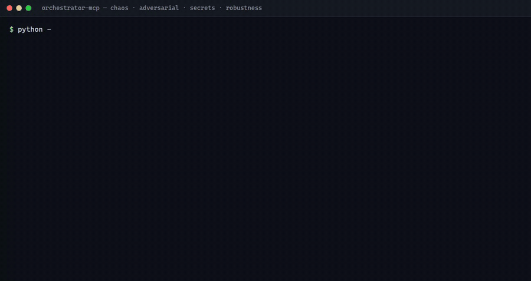
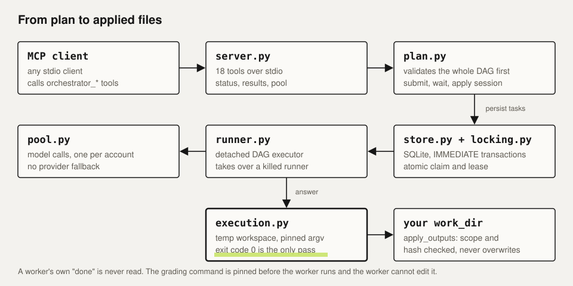

<div align="center">

# orchestrator-mcp

**An MCP server that runs a DAG of coding tasks across a pool of model workers, and only believes an exit code.**




<sub>Real output of `test_chaos`, `test_adversarial`, `test_secrets`, `test_robustness` · [mp4](docs/media/tests-terminal.mp4)</sub>

</div>

---

## The problem

Handing work to cheap model workers is easy. Trusting what they say is not: a worker will happily report "done" on code that does not run, rewrite the test that grades it, or echo a secret it saw in context. This server makes those failures structurally impossible rather than unlikely.

## What it does

- **Plans as a DAG.** `orchestrator_submit_plan` validates the whole graph first (bad plans create nothing), then freezes it and optionally starts it. Independent tasks run in parallel; dependent tasks receive upstream answers automatically.
- **Blind acceptance.** Each task carries an argv `acceptance_command`. The harness runs it itself, after pinning the command, tests and scope. *Success is exit code 0, never a worker's claim.* The model cannot rewrite the script it is graded by.
- **Leases and locks.** Atomic task claims, one lease per account across processes, 429/auth cooldowns, quota-aware account choice. Twenty threads racing for one task complete it once.
- **Detached, crash-safe runner.** One runner process per session; a hard-killed runner is taken over and the session still completes. A second start returns the same PID.
- **Hash-checked apply.** Accepted output is applied with backups and source-hash checks; if you edited the file meanwhile, apply refuses instead of overwriting.
- **Adversarial hygiene.** Context reaches the model only as a JSON data field; injected instructions cannot widen scope; secret-shaped output is refused and never written; binary, NUL and oversized output is rejected; Windows device names are refused.

## Architecture



## Tools (18)

Plan-level: `orchestrator_submit_plan`, `orchestrator_wait`, `orchestrator_get_result`, `orchestrator_apply_session`.
Step-level: `orchestrator_init`, `orchestrator_add_task`, `orchestrator_configure_task`, `orchestrator_run_session`, `orchestrator_get_status`, `orchestrator_apply_task`, `orchestrator_cancel_session`, `orchestrator_reset_session`.
Pool: `orchestrator_refresh_quotas`, `orchestrator_pool_status`, `orchestrator_list_sessions`. Plus legacy task-claim tools kept for compatibility.

## Quick start

```bash
python -m pip install -r requirements.txt
python -m unittest discover -s . -p "test_*.py"     # 103 tests, fully offline
```

Register `server.py` in your MCP client config. Real model calls are **off** until you opt in:

```bash
export ORCHESTRATOR_GEMINI_ENABLED=1
```

### Configuration (environment)

| Variable | Default | Meaning |
|---|---|---|
| `ORCHESTRATOR_DB_PATH` | `~/.orchestrator/orchestrator.db` | SQLite state |
| `ORCHESTRATOR_ARTIFACTS_DIR` | `~/.orchestrator/artifacts` | saved task outputs |
| `ORCHESTRATOR_POOL_ROOT` | `~/.orchestrator/cpa-pool` | per-account proxy folders `h01..h15` |
| `ORCHESTRATOR_CPA_BINARY` | `cli-proxy-api` on `PATH` | local proxy executable |
| `ORCHESTRATOR_CAPACITY_WAIT` | `180` | seconds to wait for a free account |
| `ORCHESTRATOR_UPSTREAM_UA` | provider client string | upstream identity header (see [SECURITY.md](SECURITY.md)) |
| `ORCHESTRATOR_MCP_CONFIG` | `~/.gemini/config/mcp_config.json` | client config that `install.py` edits |
| `ORCHESTRATOR_GEMINI_ENABLED` | unset (off) | opt in to real model calls |

## Typical session

1. `orchestrator_refresh_quotas()` shows which accounts have headroom (unknown quota is never treated as full).
2. `orchestrator_submit_plan(goal, work_dir, tasks, start=true)`; each task has `context_files`, `output_files`, and an `acceptance_command` argv list.
3. `orchestrator_wait(session_id)`, then `orchestrator_get_status(..., format="json")` for real exit codes, attempts and evidence paths.
4. Review, then `orchestrator_apply_session` applies accepted tasks in dependency order; dirty files are reported, not overwritten.

Per task: 1–3 attempts, 120 s per command, plus a session-wide attempt cap. Late or cancelled results are rejected.

## Test suites

| Suite | Covers |
|---|---|
| `test_orchestrator`, `test_robustness`, `test_wire_plan` | DAG semantics, wire protocol, plan/apply flow |
| `test_chaos` | provider fault matrix, hard-killed runner takeover, 20-thread claim race |
| `test_adversarial` | acceptance hijack, injection, giant/binary output |
| `test_secrets` | secret-shape detection, never echoed or written |
| `test_adaptive`, `test_edits`, `test_plan_overlap`, `test_speed`, `test_bench` | scheduling, edit application, overlap rules, timing |
| `evals/` | held-out benchmark harness (needs live quota; not run by default) |

## Limits

Task workspaces are temp copies, **not** an OS sandbox: acceptance commands and generated code run with your user rights. Workers see only the files you list; they are not repo-roaming agents. Cancelling an in-flight HTTP call can take up to 120 s. Passing tests do not guarantee success on very large repos or multi-hour jobs.

Status: personal research tool, source public for viewing, all rights reserved ([LICENSE](LICENSE)).
