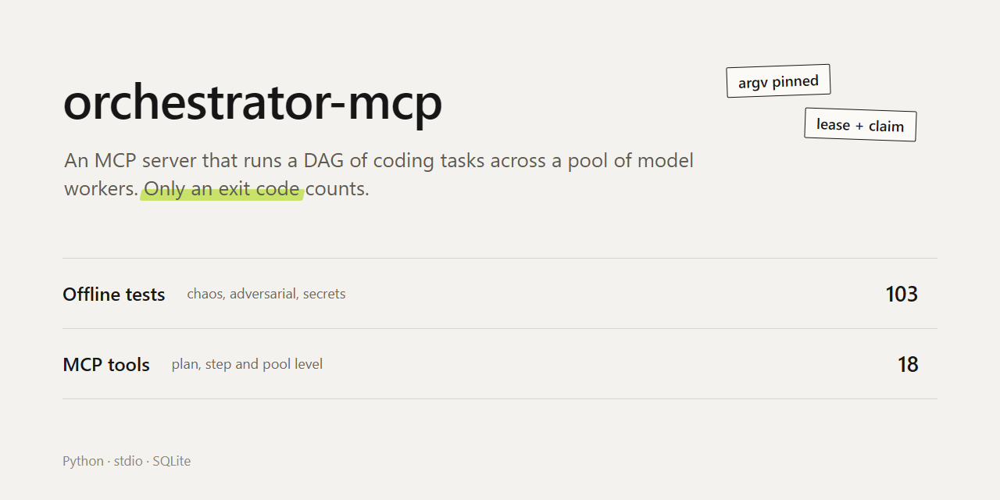
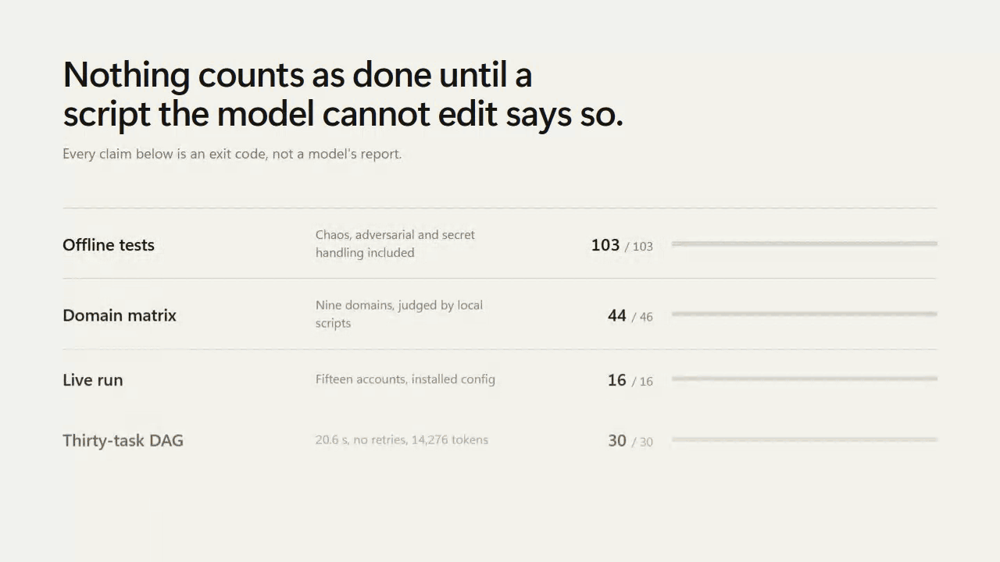
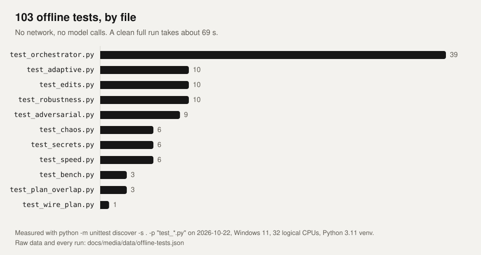
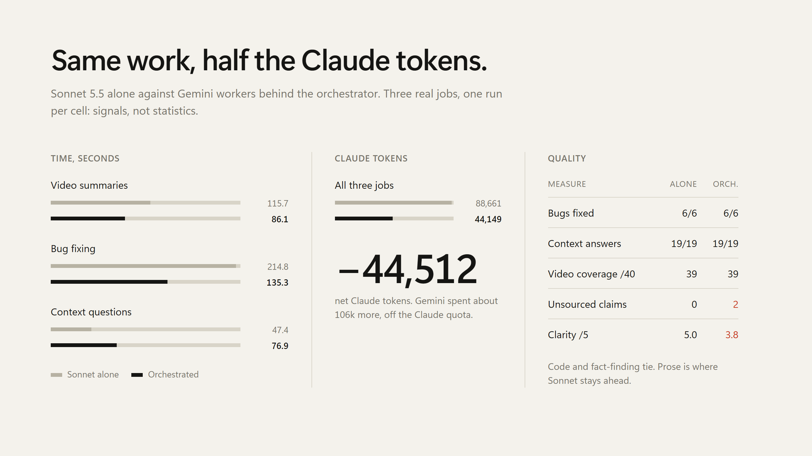

<p align="center"></p>
<p align="center"><a href="README.md">English</a> · <b>Türkçe</b></p>

Kodlama görevlerinden oluşan bir DAG'ı model işçi havuzunda çalıştıran ve yalnız çıkış koduna inanan bir MCP sunucusu.



## Neden

Ucuz işçiye iş vermek kolay, ona güvenmek zor. İşçi çalışmayan koda "bitti" der, kendisini notlayan testi yeniden yazar ya da bağlamda gördüğü bir sırrı çıktıya döker. Bu sunucu bu hataları düşük ihtimal olmaktan çıkarıp yapısal olarak imkânsız kılar.

## Nasıl çalışır


**Plan bir graf.** `orchestrator_submit_plan` (`plan.py`) önce bütün DAG'ı doğrular; hatalı plan hiçbir şey oluşturmaz. Bağımsız görevler paralel koşar, bağımlı görevler önceki cevapları alır.

**Kör kabul.** Her görev argv biçiminde bir kabul komutu taşır. `execution.py` bu komutu sabitler, geçici bir çalışma alanında koşar ve yalnız 0 çıkış kodunu başarı sayar. Model kendisini notlayan betiği değiştiremez.

**Yapısı gereği güvenli.** Görev sahiplenme ve hesap kiralama atomiktir (`store.py`, her sahiplik değişimi tek IMMEDIATE işlem). Sert öldürülen bir `runner.py`'nin işi devralınır ve oturum yine tamamlanır. Uygulama kapsam ve hash kontrollüdür: o arada senin düzenlediğin dosya raporlanır, üzerine asla yazılmaz. Sır biçimli çıktı, ikili çıktı, yol kaçışı ve Windows aygıt adları reddedilir.

## Sayılar



Çevrimdışı takımda 103 test var; ağ ya da model çağrısı yapmaz. 2026-10-22 ölçümü: temiz bir tam koşu 1 atlamayla (test makinesinde sembolik bağ yetkisi yok) yaklaşık 69 sn'de geçer. Bütün koşular [`docs/media/data/offline-tests.json`](docs/media/data/offline-tests.json) içinde.

Canlı koşuda 46 matris görevinin 44'ü ve kurulu yapılandırmadaki 16 görevin 16'sı on beş hesapla geçti (16-17 Ekim 2026). Tek başına çalışan Sonnet 5.5'e göre orkestrasyonlu koşu net Claude token'ının yaklaşık yarısını kullandı, %21 daha az sürdü, kod kalitesi eşitti. Anlatım netliği daha düşüktü; işçinin altmış alıntısından ikisi uydurmaydı ve mekanik kontrol bunları yakaladı.



Bütün tablolar, testlerin bulduğu üç güvenlik açığı ve tek gerçek hata [RESULTS.md](RESULTS.md) içinde. Ham veri ve puanlayıcılar [`evidence/`](evidence/) altında.

## Hızlı başlangıç

```bash
python -m pip install -r requirements.txt
python -m unittest discover -s . -p "test_*.py"
```

Takım tamamen çevrimdışı. Sonra `server.py`'yi MCP istemci yapılandırmana stdio sunucusu olarak ekle:

```json
{
  "mcpServers": {
    "orchestrator": {
      "command": "python",
      "args": ["-X", "utf8", "/path/to/orchestrator-mcp/server.py"]
    }
  }
}
```

Gerçek model çağrıları `ORCHESTRATOR_GEMINI_ENABLED=1` ile açıkça izin verene kadar kapalı kalır.

## Araçlar

Plan düzeyi: `orchestrator_submit_plan`, `orchestrator_wait`, `orchestrator_get_result`, `orchestrator_apply_session`.
Adım düzeyi: `orchestrator_init`, `orchestrator_add_task`, `orchestrator_configure_task`, `orchestrator_run_session`, `orchestrator_get_status`, `orchestrator_apply_task`, `orchestrator_cancel_session`, `orchestrator_reset_session`.
Elle işçi: `orchestrator_get_next_action`, `orchestrator_record_result`, `orchestrator_save_artifact`.
Havuz: `orchestrator_refresh_quotas`, `orchestrator_pool_status`, `orchestrator_list_sessions`.

## Yapılandırma

| Değişken | Varsayılan |
|---|---|
| `ORCHESTRATOR_DB_PATH` | `~/.orchestrator/orchestrator.db` |
| `ORCHESTRATOR_ARTIFACTS_DIR` | `~/.orchestrator/artifacts` |
| `ORCHESTRATOR_POOL_ROOT` | `~/.orchestrator/cpa-pool` |
| `ORCHESTRATOR_CPA_BINARY` | `PATH` üzerindeki `cli-proxy-api` |
| `ORCHESTRATOR_CAPACITY_WAIT` | `180` saniye |
| `ORCHESTRATOR_UPSTREAM_UA` | sağlayıcı istemci dizesi, bkz. [SECURITY.md](SECURITY.md) |
| `ORCHESTRATOR_MCP_CONFIG` | `~/.gemini/config/mcp_config.json` |
| `ORCHESTRATOR_GEMINI_ENABLED` | tanımsız, model çağrıları kapalı |

## Sınırlar

- Görev çalışma alanları geçici kopyadır, işletim sistemi sandbox'ı değildir. Kabul komutları ve üretilen kod senin kullanıcı yetkinle çalışır. İşçi yalnız listelediğin dosyaları görür.
- Süren bir HTTP çağrısını iptal etmek 120 saniyeye kadar sürebilir.
- `test_chaos.HardKill` zamanlamaya duyarlı. 2026-10-22'de CPU'yu başka ağır bir iş paylaşırken 6 tam koşunun 2'sinde düştü; boşta yapılan her koşuda ve tek başına 3/3 geçti.

## Lisans

[Apache Lisansı 2.0](LICENSE) ile lisanslıdır. Herhangi bir sağlayıcı hesabına karşı çalıştırmadan önce [SECURITY.md](SECURITY.md)'yi oku.

Önceki README [docs/NOTES.md](docs/NOTES.md) içinde duruyor.
